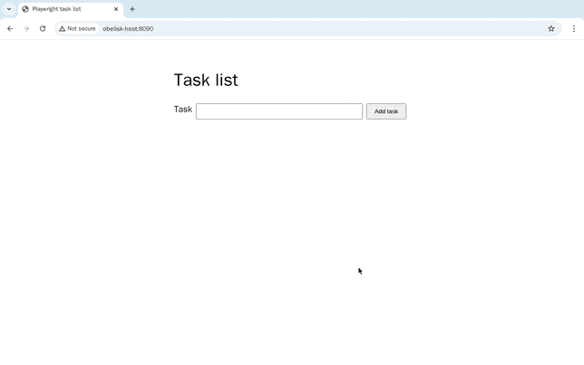
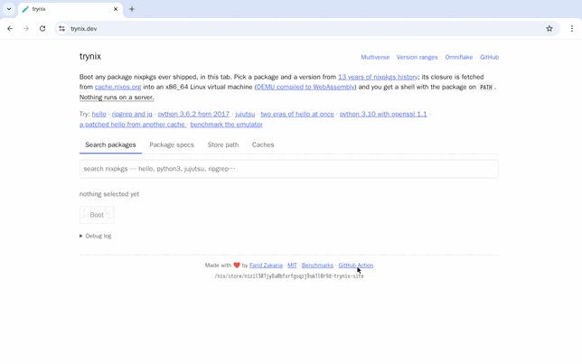

# Playwright browser automation demo

Two [Obelisk](https://obeli.sk) apps drive a Chromium browser with
[Playwright](https://playwright.dev) from durable JavaScript workflows:

- [todoapp/](todoapp/) adds a task to a small task-list page:

  

- [inception/](inception/) opens [trynix.dev](https://trynix.dev/), boots Obelisk in a VM running
  inside the browser tab and returns the output of `obelisk -v`:

  

## How it works

In Obelisk, a [workflow](https://obeli.sk/docs/latest/concepts/workflows/) is deterministic code
that calls [activities](https://obeli.sk/docs/latest/concepts/activities/), which do the actual
work, here driving the browser. Obelisk records every activity result, so a workflow interrupted
by a crash or restart continues where it left off instead of starting over.

Obelisk retries an activity that fails or times out, so activities must be idempotent: running one
twice must have the same effect as running it once. An activity also keeps no state between runs;
all it gets is its parameters. Anything stateful, such as a browser with an open page, lives in an
external resource like a Docker container. The container of the multi-step workflows is
provisioned and cleaned up by a workflow (see
[Cleaning up the browser](#cleaning-up-the-browser)).

Each app comes with two workflows:

- **Single step** (`just todoapp`, `just inception`): one activity opens a browser, runs a
  Playwright snippet and closes the browser.
- **Multi step** (`just todoapp-multistep`, `just inception-multistep`): one browser stays open
  in a Docker container while the workflow calls several activities on it, one per step. You can
  watch the browser through VNC and step through the workflow yourself.

The browser runs in a Docker container built from this repository. Both workflows work.
Obelisk 0.43.0-rc.17 removed activity VMs; use the Docker deployments for browser automation.

## Setup

1. Install [Nix](https://nixos.org/download/). Also start a Docker daemon for browser automation.
2. Enter the development shell and create an API token for the Obelisk CLI:

   ```sh
   nix develop
   export OBELISK_API_TOKEN=$(obelisk generate token)
   export OBELISK_API_URL=http://127.0.0.1:5005
   export OBELISK_WEBUI_URL=http://127.0.0.1:8080
   ```

   With [direnv](https://direnv.net), copy `.envrc-example` to `.envrc` and run `direnv allow`
   instead. Every shell that runs `just` needs the same token.
   Set the URL variables to your configured listeners; the API and screenshot
   helpers require them rather than guessing addresses. These are external
   shell settings. Obelisk's internal URL sources are injected only into components.
3. Build the browser image with `just build`.

## Run

Start the server for one app, then run the workflows from another shell as described
in [todoapp/README.md](todoapp/README.md) and [inception/README.md](inception/README.md):

```sh
just serve todoapp docker
just serve inception docker
```

Run one server at a time, since both use the same port. The server also serves a web UI at
<http://127.0.0.1:8080>, which shows each execution and its activities.

### Stepping through a workflow

The multi-step commands start the browser, then print the execution ID (`E_...`) of the workflow
that drives it. That workflow is **paused**: it does nothing until you tell it to continue.

- `just advance E_...` calls Obelisk's
  [advance API](https://obeli.sk/docs/latest/cli/#advancing-a-paused-execution), which replays the
  workflow up to its next step, such as calling the next activity, applies that step and keeps the
  workflow paused. The activity itself runs to the end, so wait for the browser to change before
  advancing again.
- `just unpause E_...` lets the workflow run to the end.
- `just cancel E_...` stops it early. The browser is still removed, as described below.

### Cleaning up the browser

A browser container left behind by a failed, cancelled or abandoned run would keep running
forever. The multi-step workflows prevent that with the
[cleanup supervisor](https://obeli.sk/docs/latest/patterns/cleanup-supervisor/) pattern, a saga
whose one compensating step removes the container:

1. An outer workflow, `*-multistep.run`, starts the container.
2. It submits the inner workflow, `*-steps.run-cancellable`, which drives the browser, and a
   one-hour timer. Whichever finishes first wins; if the timer wins, the inner workflow is
   cancelled.
3. The outer workflow removes the container whether the inner one succeeded, failed, was cancelled
   or timed out, and then returns its result.

The `-cancellable` suffix lets the inner workflow be
[cancelled](https://obeli.sk/docs/latest/concepts/structured-concurrency/#cancellation) from
outside, by `just cancel` or the timer, without running any more of its code. The outer workflow
is not cancellable, so its cleanup always runs. Because Obelisk records each step, the cleanup also
runs after a server crash or restart. The execution ID that `just advance` takes is the inner
workflow's; the outer one is printed as `Supervisor`.

## Layout

- `todoapp/` and `inception/` each hold one app: its workflows, `app-docker.toml`,
  `deployment-docker.toml` and `server-docker.toml`.
- [runner/docker/](runner/docker/) holds the browser image and the scripts Obelisk calls as activities.
- [scripts/](scripts/) holds the helpers behind the `just` commands.
- [bench/](bench/) holds host exec activities and historical benchmark results.

## Benchmarks

[bench/](bench/) provides host exec activities for Bash `printf` and curl of the local todoapp
page. `just bench` also measures the existing single-step todoapp and inception activities. It
prints CSV with each activity's persisted `Locked` to `Finished` duration, after two warmup runs
by default:

```sh
just serve-page                  # separate terminal, needed for curl and todoapp
just serve bench exec
just bench echo exec > echo.csv  # separate terminal
just bench curl exec > curl.csv
```

For browser workloads, run `just serve todoapp docker` or `just serve inception docker`, then
`just bench todoapp docker` or `just bench inception docker`. The backend argument labels the
output; the running server selects the actual backend. Exec timings exclude VM boot and sandbox
setup, so they measure a different execution path from the historical VM results retained in
[bench/README.md](bench/README.md).

## Development

`just verify-docker` checks both browser deployments; `just verify-exec` checks the benchmark
deployment. `just test-e2e docker` runs the todoapp workflows end to end, and `just test-bench`
checks both exec workloads and their CSV measurements without Docker.

Obelisk only runs activity scripts whose digest is approved. After changing a script in
`runner/docker/`, run `just verify-docker` and copy the digests it prints into both apps'
`app-docker.toml` and `server-docker.toml`. Benchmark scripts require matching approvals in
`bench/app-exec.toml` and `bench/server-exec.toml`. These host exec grants authorize exactly the
reviewed scripts; they do not provide the removed VM backend's HTTP interception.

The browser runner is adapted from the MIT-licensed `obeli-sk/components` Playwright component.
